# Enterprise Windows Domain & IAM Lifecycle Automation Lab

**Windows Server 2025 · Active Directory · Windows 11 · VMware Workstation · PowerShell · Group Policy · SMB/NTFS · IAM / IT Support**

> **Portfolio lab:** A self-built, isolated Windows enterprise environment used to practice infrastructure deployment, Active Directory administration, identity lifecycle automation, workstation hardening, role-based file access, and documented help desk troubleshooting. **All employees and help desk tickets are fictional.** This project is a lab simulation, not a production deployment.

## Executive summary

I deployed a Windows Server 2025 domain controller (**DC01**) and joined a Windows 11 Pro workstation (**CLIENT01**) to the `corp.tetsalab.test` Active Directory domain. I structured departmental OUs and global security groups, then created and executed PowerShell scripts to automate employee **Joiner–Mover–Leaver (JML)** operations. I validated changes through independent Active Directory queries, deployed a workstation inactivity-lock Group Policy, and tested both permitted and denied access to an SMB Finance share using separate domain user accounts.

I also investigated three simulated IT support cases: a real DNS misconfiguration encountered during setup, a deliberately triggered AD account lockout, and an access-denied report ultimately determined to be **expected least-privilege enforcement**.

### Demonstrated outcomes

| Activity | Observed lab result |
|---|---|
| Domain deployment | `corp.tetsalab.test` created; `CLIENT01` joined and verified |
| Organizational design | IT, Finance, HR, Sales user OUs; groups; Workstations and DisabledUsers OUs |
| User onboarding | **8 of 8** CSV users created; **9 total** lab employee accounts verified initially (including one manually created account) |
| Placement/access checks | **9 of 9** users matched expected departmental OU and group in initial validation |
| Mover | Avery Johnson moved Sales → Finance; previous departmental group removed, new group added |
| Leaver | Cameron Davis disabled, Sales group removed, moved to DisabledUsers |
| Workstation policy | `GPO-Workstations-Security-Baseline` applied on CLIENT01; 900-second inactivity limit verified |
| Resource-based access | Finance user could read/write; IT user was denied; transferred Finance employee could read/write |
| ITSM-style investigations | **3** documented simulated support cases, with screenshots and technical findings |

## Contents

1. [Lab architecture](#lab-architecture)
2. [Deployment and domain integration](#deployment-and-domain-integration)
3. [Active Directory design](#active-directory-design)
4. [PowerShell JML automation](#powershell-jml-automation)
5. [Workstation Group Policy](#workstation-group-policy)
6. [Finance share access control](#finance-share-access-control)
7. [IT help desk investigations](#it-help-desk-investigations)
8. [Repository files and reproducibility](#repository-files-and-reproducibility)
9. [Lessons learned and limitations](#lessons-learned-and-limitations)

## Lab architecture

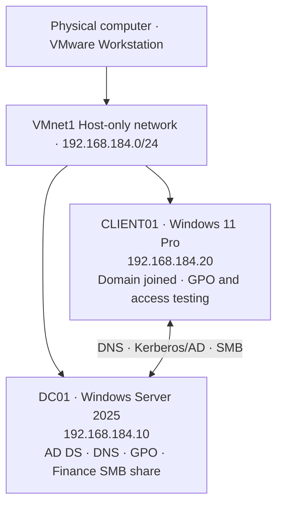

- **Hypervisor:** VMware Workstation, using an isolated host-only virtual network.
- **Domain:** `corp.tetsalab.test` (lab-only namespace).
- **DC01:** AD DS, DNS, Group Policy management and, for this two-VM lab, the Finance SMB share.
- **CLIENT01:** Windows 11 Pro joined to the domain for authentication, Group Policy and resource-access validation.
- **Networking:** Static IPv4 addresses, with the workstation configured to use DC01 for AD-capable DNS. The initial incorrect CLIENT01 DNS address was investigated as a support incident.

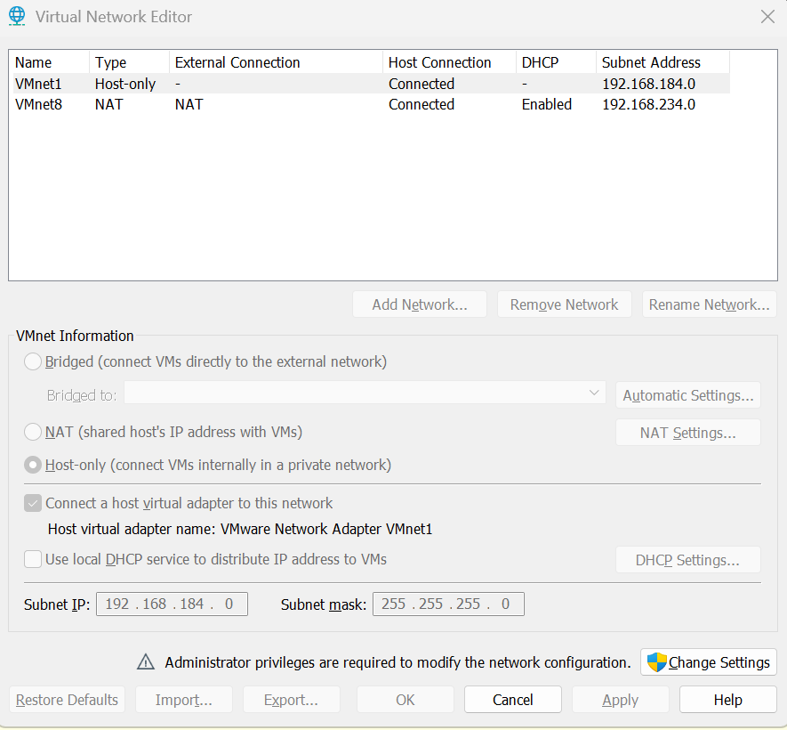

## Deployment and domain integration

I installed Windows Server 2025 with Desktop Experience, renamed it `DC01`, configured static networking, installed the Active Directory Domain Services role, and promoted the server to a new forest. I verified the domain and the DNS SRV records used in domain-controller discovery. I configured CLIENT01's DNS settings, joined it to `corp.tetsalab.test`, and verified both the computer's domain membership and its AD computer account.

| Milestone | Evidence |
|---|---|
| Windows Server 2025 setup | [Server setup](screenshots/00-windows-server-2025-setup.png) |
| Server IP and AD DS installation | [DC01 IP configuration](screenshots/02-dc01-static-ip-configuration.png) · [AD DS role verification](screenshots/06-adds-role-verification.png) |
| Domain controller promotion | [DC options](screenshots/09-domain-controller-options.png) · [Prerequisite checks](screenshots/10-ad-ds-prerequisites-check.png) |
| DNS/DC discovery | [DNS SRV verification](screenshots/13-active-directory-dns-verification.png) |
| Windows 11 domain join | [Welcome to domain](screenshots/16-successful-domain-join.png) · [Membership verification](screenshots/17-client01-domain-membership.png) |
| Network troubleshooting | [ICMP rule](screenshots/00-dc01-icmp-firewall-rule.png) · [Successful ping](screenshots/05-dc01-client01-connectivity.png) |

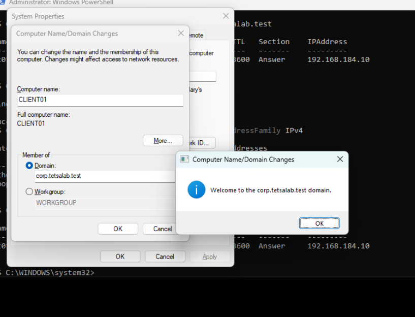

**Troubleshooting example:** Initially, CLIENT01 used itself (`192.168.184.20`) as its DNS server. After changing DNS to DC01 (`192.168.184.10`), name resolution succeeded and the workstation joined the domain. See [INC-001](docs/incidents/INC-001-dns-resolution-failure.md).

## Active Directory design

I organized the domain using departmental and lifecycle-specific OUs:

```text
corp.tetsalab.test
└── TetsaLab
    ├── Users
    │   ├── IT
    │   ├── Finance
    │   ├── HR
    │   └── Sales
    ├── Groups
    ├── Workstations
    └── DisabledUsers
```

The departmental **Global/Security** groups are `GG_IT_Users`, `GG_Finance_Users`, `GG_HR_Users`, and `GG_Sales_Users`. I moved CLIENT01 to `TetsaLab/Workstations` for workstation-scoped GPO management.

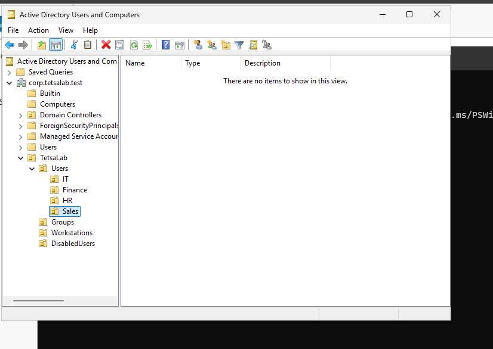

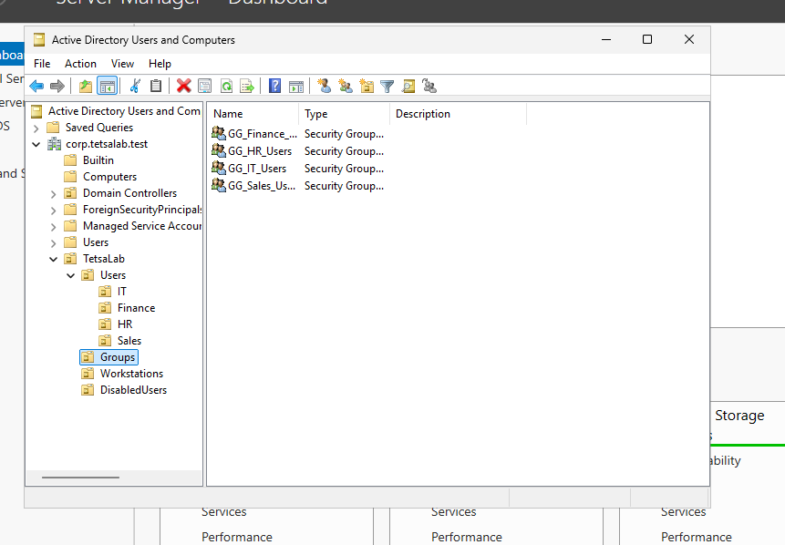

## PowerShell JML automation

The repository contains the actual PowerShell files used in the lab, plus a CSV of **fictional** employee records. The scripts require the ActiveDirectory module, specifically target `corp.tetsalab.test`, show a **preview by default**, and support `-Apply -WhatIf` before live changes.

### 1. Joiner — CSV employee provisioning

**Script:** [`scripts/New-ADLabUsers.ps1`](scripts/New-ADLabUsers.ps1)  
**Sample data:** [`sample-data/employees.csv`](sample-data/employees.csv)

The script validates records, checks for existing users, maps departments to OUs and groups, and creates new accounts with a securely entered temporary lab password. Eight accounts were created successfully. Initial verification checked all nine fictional employees, including manually provisioned Alex Morgan.

```powershell
# Run from DC01; adjust CSV path if needed
& ".\scripts\New-ADLabUsers.ps1" -CsvPath ".\sample-data\employees.csv"
& ".\scripts\New-ADLabUsers.ps1" -CsvPath ".\sample-data\employees.csv" -Apply -WhatIf
# Only in an authorized disposable lab after reviewing the plan:
# & ".\scripts\New-ADLabUsers.ps1" -CsvPath ".\sample-data\employees.csv" -Apply
```

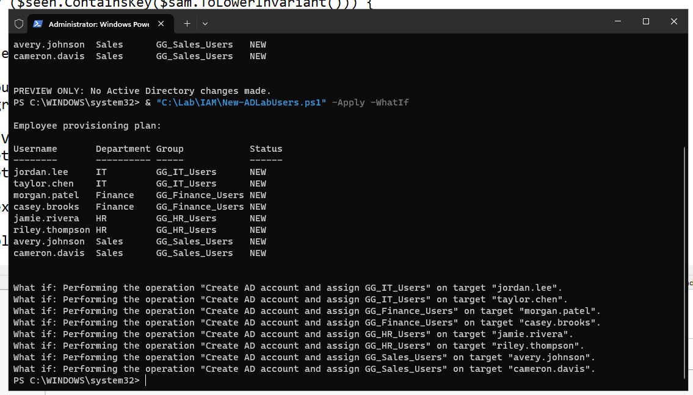

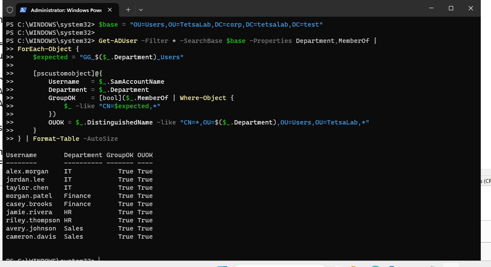

### 2. Mover — Department transfer

**Script:** [`scripts/Move-ADLabUser.ps1`](scripts/Move-ADLabUser.ps1)

Transferred Avery Johnson from **Sales to Finance** by removing the old Sales group, assigning Finance membership, moving the AD object to the Finance OU, and updating the Department attribute. Independent verification confirmed all three checks (`FinanceOU`, `FinanceGroup`, `SalesRemoved`) were `True`.

```powershell
& ".\scripts\Move-ADLabUser.ps1" -SamAccountName "avery.johnson" -NewDepartment "Finance"
& ".\scripts\Move-ADLabUser.ps1" -SamAccountName "avery.johnson" -NewDepartment "Finance" -Apply -WhatIf
```

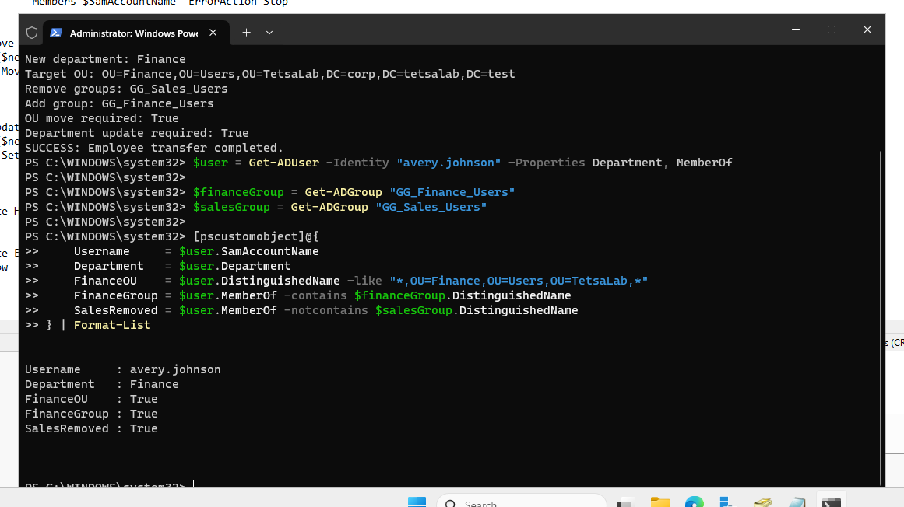

### 3. Leaver — Account offboarding

**Script:** [`scripts/Disable-ADLabUser.ps1`](scripts/Disable-ADLabUser.ps1)

Disabled Cameron Davis, removed the Sales departmental group, and moved the account to `TetsaLab/DisabledUsers`. Post-execution validation returned `True` for account disabled, destination OU, and group removal.

```powershell
& ".\scripts\Disable-ADLabUser.ps1" -SamAccountName "cameron.davis"
& ".\scripts\Disable-ADLabUser.ps1" -SamAccountName "cameron.davis" -Apply -WhatIf
```

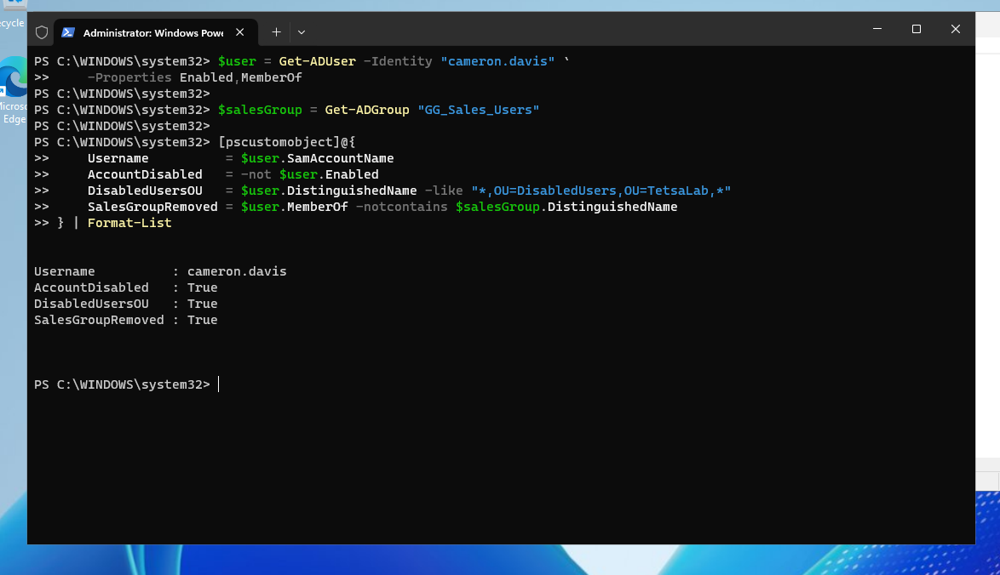

> **Scope:** These are lab scripts, **not production-ready identity governance solutions**. A multi-step AD operation can fail partway through, and the scripts do not implement transactional rollback, full audit logging, approvals, reconciliation of all entitlements, session revocation, or downstream SaaS deprovisioning. Initial passwords are handled as a single lab prompt, which is not an enterprise provisioning design. See [security notes](docs/security-and-limitations.md).

## Workstation Group Policy

I linked `GPO-Workstations-Security-Baseline` to the Workstations OU and configured **Interactive logon: Machine inactivity limit** to **900 seconds (15 minutes)**. On CLIENT01, `gpresult /scope computer /r` showed the GPO as applied, and the `InactivityTimeoutSecs` registry value returned `900`.

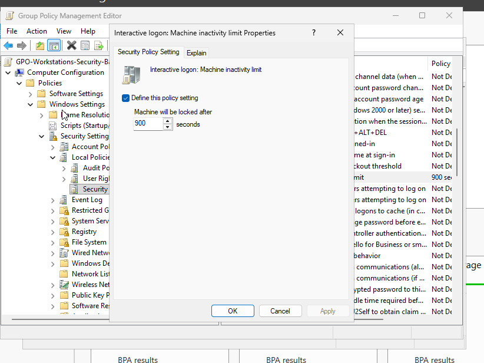

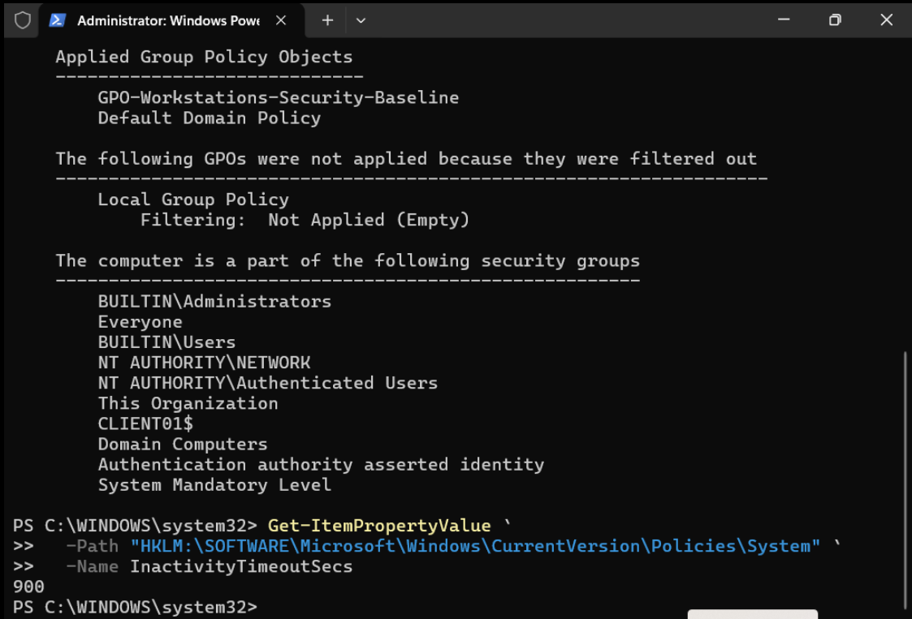

## Finance share access control

To apply **AGDLP** (Accounts → Global groups → Domain Local groups → Permissions), I nested `GG_Finance_Users` inside `DL_Finance_Share_Modify`, granted that domain local group **Modify** NTFS access and **Change** SMB access, and retained full administrative/system permissions. The SMB share was hosted on DC01 **for lab convenience only**.

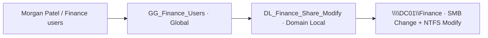

| Access test on CLIENT01 | Observed result |
|---|---|
| `CORP\morgan.patel` (Finance) | Read existing document, created new document, read it back |
| `CORP\jordan.lee` (IT) | Received **Access is denied** on Finance document |
| `CORP\avery.johnson` after Finance transfer | Read existing document, created and read a new document |

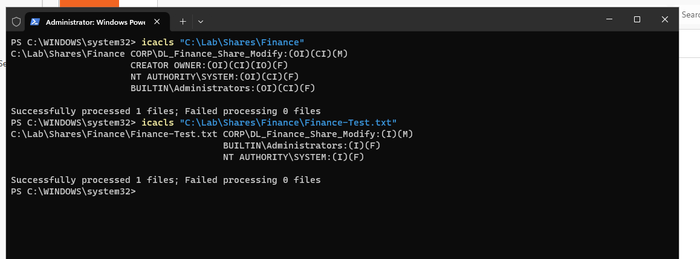

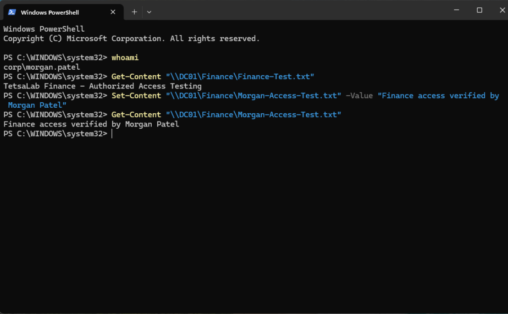

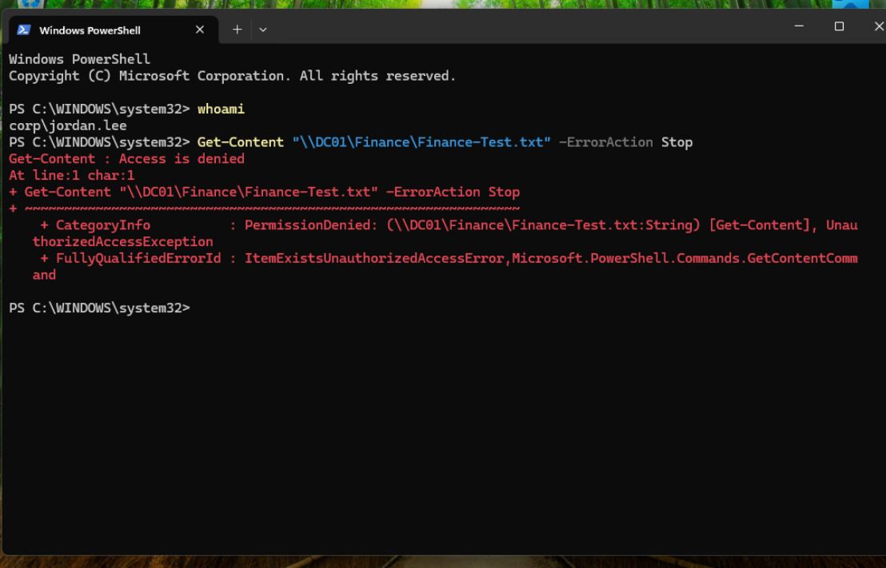

The test establishes these **specific resource-access results**; it is not a claim that every possible entitlement, file, session, or lateral path was exhaustively assessed.

## IT help desk investigations

Three **simulated** tickets demonstrate diagnosis, remediation/decision-making, and evidence-based documentation. They were documented using an ITSM-inspired format; they were **not created as tickets in a live ServiceNow system**.

| Ticket | Scenario | Investigation outcome | Report |
|---|---|---|---|
| **INC-001** | DNS resolution and domain join failure | Incorrect CLIENT01 DNS address corrected; AD name resolution and domain membership verified | [Read INC-001](docs/incidents/INC-001-dns-resolution-failure.md) |
| **INC-002** | Domain account lockout | Fine-grained policy applied to isolated fictional user; Event ID 4740 with caller CLIENT01; authentication later restored | [Read INC-002](docs/incidents/INC-002-account-lockout-recovery.md) |
| **INC-003** | IT employee denied Finance share access | Verified intended group/SMB/NTFS restrictions; no unauthorized access granted | [Read INC-003](docs/incidents/INC-003-finance-share-access-denied.md) |

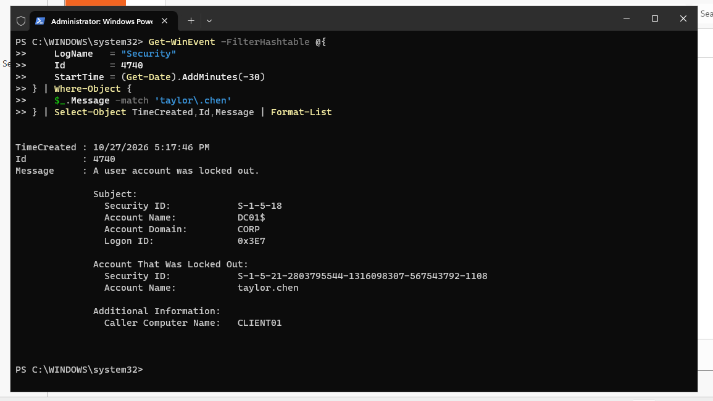

## Repository files and reproducibility

```text
Enterprise-Windows-Domain-IAM-Lifecycle-Automation/
├── README.md
├── scripts/
│   ├── New-ADLabUsers.ps1
│   ├── Move-ADLabUser.ps1
│   └── Disable-ADLabUser.ps1
├── sample-data/
│   └── employees.csv
├── screenshots/
│   └── ...numbered lab evidence and supplemental setup captures...
└── docs/
    ├── evidence-index.md
    ├── reproduction-guide.md
    ├── security-and-limitations.md
    └── incidents/
        ├── INC-001-dns-resolution-failure.md
        ├── INC-002-account-lockout-recovery.md
        └── INC-003-finance-share-access-denied.md
```

- [Evidence index](docs/evidence-index.md): screenshots and their purpose.
- [Lab reproduction guide](docs/reproduction-guide.md): prerequisites, commands, and safe execution order.
- [Security and limitations](docs/security-and-limitations.md): explicit boundaries between lab results and production practices.

## Lessons learned and limitations

- **DNS is foundational to AD:** successful ping does not guarantee that domain-controller DNS records can be resolved.
- **Preview and verify changes:** dry-run/`-WhatIf` output is useful, but post-change AD queries and actual user sign-ins are essential.
- **Least privilege must be tested:** read/write success for Finance and access denial for IT demonstrated resource-level enforcement in this scenario.
- **Offboarding is more than disabling:** production workflows also need access inventories, approvals, session/token revocation, device and SaaS controls, and auditable records.
- **Incident documentation matters:** account lockouts, networking failures, and permission issues require different diagnoses; an intentional denial should not be “fixed” by weakening access rules.

**Tools:** VMware Workstation, Windows Server 2025 Standard Evaluation, Windows 11 Pro, AD DS/DNS, Group Policy Management, PowerShell ActiveDirectory module, Windows Security Events, SMB and NTFS, `icacls`, and Windows networking utilities.

---

*Created as an independently built training environment with fictional users and isolated network resources. Screenshots document lab executions; sample data contains no real employee information. Do not execute the scripts on production Active Directory without a separate security and operations review.*
